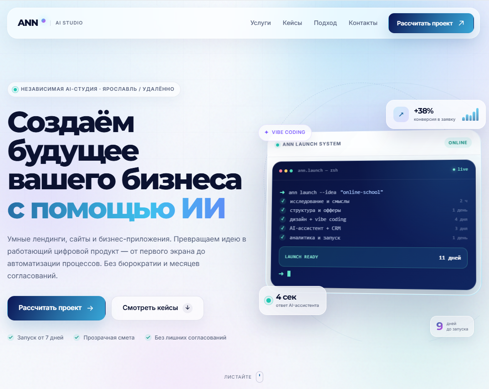
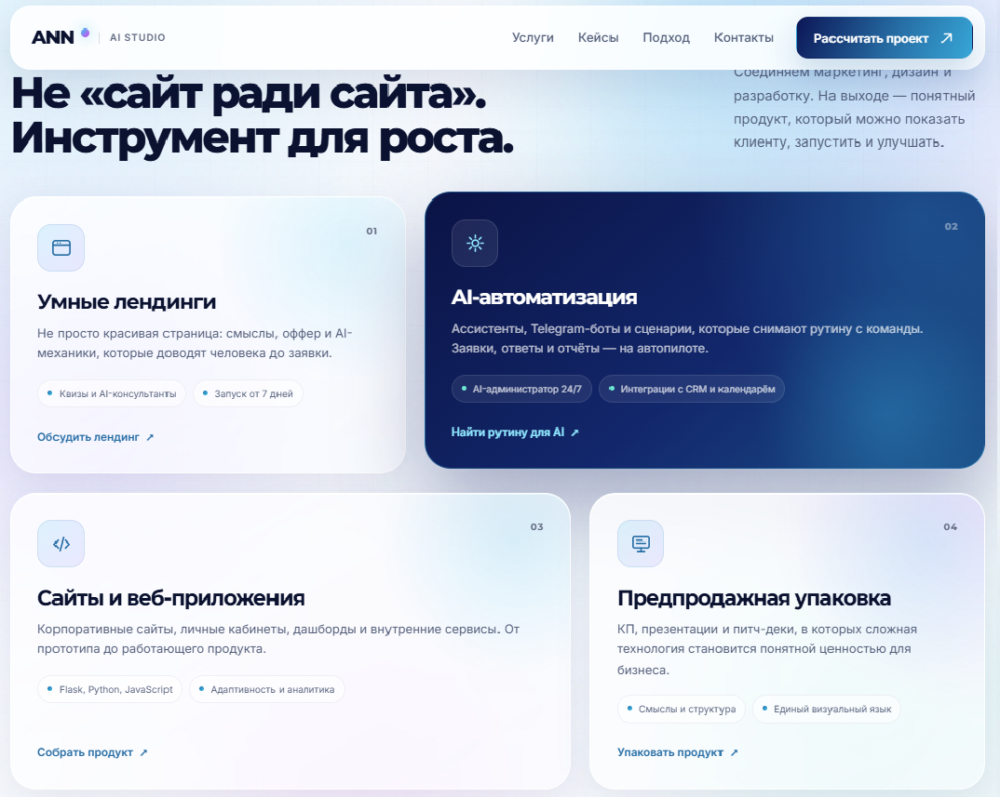
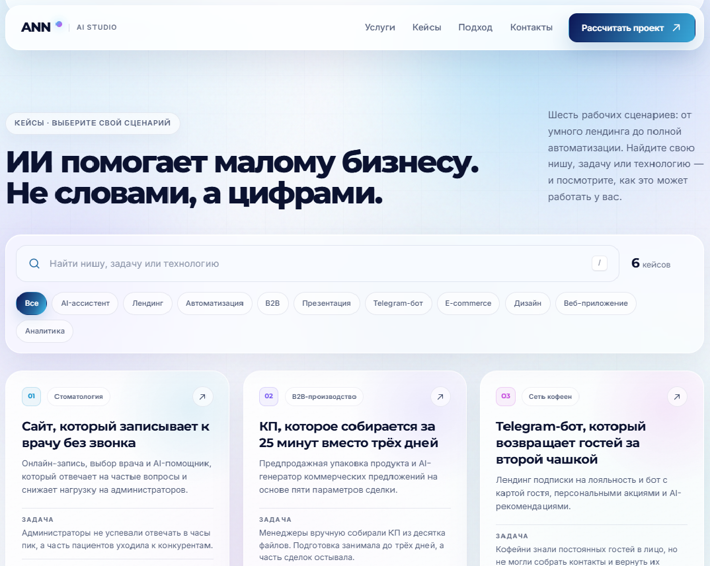
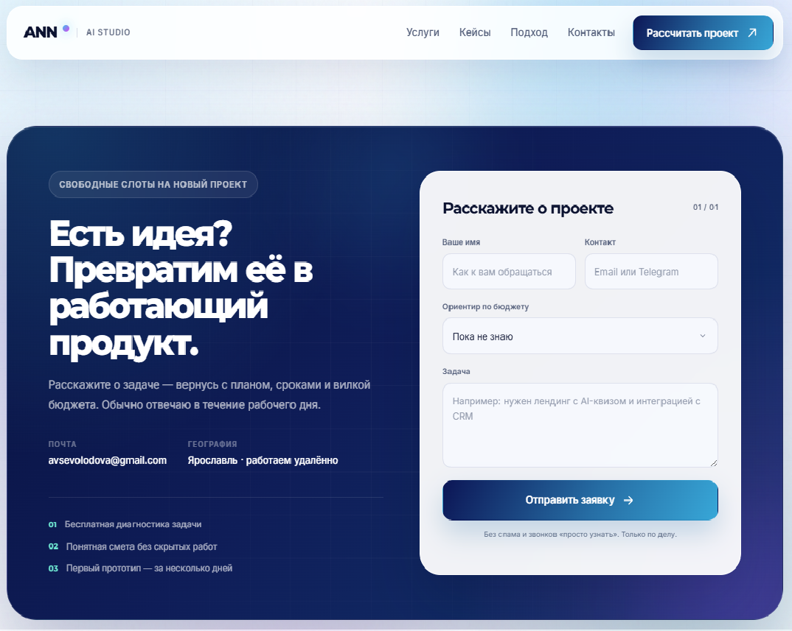

# ANN — AI-студия

Лендинг экспертной AI-студии: умные лендинги, сайты, веб-приложения и автоматизация бизнеса.

| Главный экран | Услуги |
|:---:|:---:|
|  |  |
| **Кейсы** | **Контакты** |
|  |  |

## Что внутри

- Flask-приложение с одним лендингом и модальными окнами кейсов.
- 6 кейсов с логикой **Задача → Решение → Результат**.
- Поиск по нише, задаче, решению и стеку.
- Фильтрация по тегам и счётчик результатов.
- Glassmorphism, mesh-градиенты, scroll-reveal, tilt-эффект, параллакс, анимированный терминал и счётчики.
- Адаптивная вёрстка для компьютера и телефона.
- Форма заявки на Flask с сохранением в `leads.json`.
- Опциональная отправка заявок на почту через SMTP.

## Контакты

- Email: avsevolodova@gmail.com
- Ярославль · работаем удалённо
